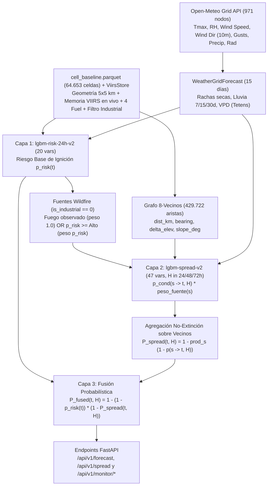

# Modelo de Propagación Espacial Multi-Horizonte de Incendios (`lgbm-spread-v2`) y Fusión Probabilística con Riesgo Base (`lgbm-risk-24h-v2`): Formulación en Grafos Dirigidos, Restricciones Físicas Monótonas y Evaluación Out-of-Time (2018–2026)

**Resumen Ejecutivo (Abstract):** Este trabajo presenta la formulación matemática, la arquitectura de ingeniería de datos libre de fuga temporal (*leak-free*) y la validación empírica out-of-time del modelo **`lgbm-spread-v2`**, diseñado para estimar la probabilidad condicional de propagación espacial de incendios hacia celdas vecinas en horizontes de **24, 48 y 72 horas** ($H \in \{1, 2, 3\}\text{ días}$) sobre la grilla nacional de **$|\mathcal{C}| = 64.653$ celdas activas de $5 \times 5\text{ km}$** de la República Argentina (`429.722` aristas dirigidas de vecindad de Moore). El sistema extiende el predictor de ignición base **`lgbm-risk-24h-v2`** mediante: (i) acoplamiento vectorial entre el rumbo geodésico fuente-destino ($\beta_{s \to t}$) y la dirección diaria del viento a $10\text{ m}$ de **NASA POWER / MERRA-2** (`WD10M`, `7.594.002` registros en `2018–2026`) y **Open-Meteo** en tiempo real; (ii) partición biofísica normalizada de cobertura de combustible por celda (`fuel_bosque`, `fuel_pastizal`, `fuel_agro`, `fuel_no_combustible`); (iii) filtrado estructural de **420 celdas con fuentes de calor fijo industrial** (`puntos_industriales.parquet`: antorchas petroquímicas, refinerías e ingenios); y (iv) restricciones monótonas exactas en árboles de decisión potenciados por gradiente ($\partial \hat{p}/\partial H \ge 0$, $\partial \hat{p}/\partial f_{\text{no\_comb}} \le 0$, $\partial \hat{p}/\partial \mathbb{I}_{\text{ind}} \le 0$). En el **holdout ciego out-of-time de 2026** (`65.078` pares fuente-vecino evaluados), **`lgbm-spread-v2`** alcanza un **$\text{ROC-AUC} = 0.8760$** (**$0.8942$** a $24\text{ h}$) y un **$\text{PR-AUC}$ poblacional de $0.4125$** (**$0.4443$** a $24\text{ h}$ en el ensamble fusionado `v2 + spread-v2`), superando en **$+11.01\%$** al modelo base `lgbm-risk-24h-v2` escalado ($0.3716$), en **$+4.47\%$** a la versión inicial sin cobertura ni dirección histórica de viento (`lgbm-spread-v1`, $0.3948$) y en **$+34.68\%$** al baseline heurístico espacial ($0.3063$), con una precisión operativa del **$73.80\%$** en el `Top-1%` de alertas (**Lift de $16.74\times$**) y un rendimiento de inferencia en CPU de **$303.253\text{ pares/s}$** ($0.215\text{ s}$ sobre todo el año 2026).

---

## Ruta Rápida de Reproducibilidad (Quick Path)

1. **Enriquecer la línea base de celdas (`cell_baseline.parquet`) y descargar dirección histórica de viento (`WD10M`):**
   ```powershell
   cd backend
   .\.venv\Scripts\python.exe scripts/fetch_wd10m.py
   .\.venv\Scripts\python.exe scripts/export_baseline.py
   ```
2. **Entrenar `lgbm-spread-v2` (`2018–2023`, validación `2024–2025`, holdout `2026`) y exportar artefactos:**
   ```powershell
   .\.venv\Scripts\python.exe scripts/train_spread.py
   ```
3. **Ejecutar el benchmark comparativo (`v2` vs `spread-v1` vs `spread-v2` vs `Fused`) y la suite de pruebas:**
   ```powershell
   .\.venv\Scripts\python.exe scripts/compare_models.py
   .\.venv\Scripts\python.exe -m pytest tests/test_forecast.py tests/test_spread.py tests/test_model_comparison.py -v
   ```

---

## 1. Formulación Matemática y Arquitectura Dual en Producción

### 1.1 El Grafo Espacial Dirigido de Vecindad de Moore ($\mathcal{G}$)
Sea $\mathcal{C} = \{1, \dots, 64.653\}$ el conjunto de celdas activas de $5 \times 5\text{ km}$ (proyección Albers Equal-Area, índice matricial exacto $\text{cell\_id} = 460 \cdot r + c$) con centroide geodésico $(\phi_i, \lambda_i)$ y altitud media $z_i$ ($\text{m s.n.m.}$). Se construye el grafo dirigido de adyacencia espacial $\mathcal{G} = (\mathcal{C}, \mathcal{E})$ donde una arista dirigida $e = (s \to t) \in \mathcal{E}$ conecta toda celda fuente $s$ con cada celda destino $t \neq s$ dentro de su anillo de 8 vecinos inmediatos ($0.1\text{ km} < d(s, t) \le 8.5\text{ km}$):

$$|\mathcal{E}| = 429.722 \text{ aristas dirigidas} \quad (\text{grado medio } \bar{k} = 6.65 \text{ vecinos/celda})$$

Para cada arista dirigida $(s \to t) \in \mathcal{E}$, se precalculan en tiempo de inicialización ($0.44\text{ s}$ mediante *spatial hashing* en cubetas de $0.055^\circ$) los invariantes geométricos y topográficos:

$$\Delta x_{s \to t} = R_\oplus \cos\!\left(\frac{\phi_s + \phi_t}{2}\right) (\lambda_t - \lambda_s), \qquad \Delta y_{s \to t} = R_\oplus (\phi_t - \phi_s)$$

$$d_{s \to t} = \sqrt{\Delta x_{s \to t}^2 + \Delta y_{s \to t}^2}, \qquad \beta_{s \to t} = \left(\text{atan2}(\Delta x_{s \to t}, \Delta y_{s \to t}) \cdot \frac{180^\circ}{\pi}\right) \bmod 360^\circ$$

$$\Delta z_{s \to t} = z_t - z_s, \qquad \alpha_{s \to t} = \arctan\!\left(\frac{\Delta z_{s \to t}}{\max(1000 \cdot d_{s \to t}, 1.0)}\right) \cdot \frac{180^\circ}{\pi}$$

donde $R_\oplus = 6371.0\text{ km}$, $\beta_{s \to t} \in [0^\circ, 360^\circ)$ es el acimut geodésico desde $s$ hacia $t$, y $\alpha_{s \to t}$ es el ángulo de pendiente topográfica en grados (positivo en ascenso hacia $t$).

### 1.2 Variable Respuesta Multi-Horizonte Condicionada a Actividad Fuente
Sea $d \in \mathcal{T}$ la fecha de inicio de pronóstico. El conjunto de **fuentes activas observadas** en el día previo $d - 1$ se define bajo la especificación armonizada `RS-ARG-FUEGO-2026-V1`:

$$\mathcal{S}_{d-1} = \left\{ s \in \mathcal{C} \;\middle|\; n_{\text{harm}}(s, d-1) \ge 1 \;\wedge\; \Phi_{\text{harm}}(s, d-1) \ge 10.0\text{ MW} \right\}$$

Para todo par candidato $(s \to t) \in \mathcal{E}$ con $s \in \mathcal{S}_{d-1}$ y para cada horizonte de predicción $H \in \{1, 2, 3\}$ días ($24\text{ h}$, $48\text{ h}$ y $72\text{ h}$), la variable respuesta binaria acumulada $Y_{s \to t}^{(H)}(d) \in \{0, 1\}$ vale $1$ si y solo si la celda vecina $t$ registra al menos un evento de fuego severo armonizado dentro de la ventana cerrada $[d,\, d + H - 1]$:

$$Y_{s \to t}^{(H)}(d) = \mathbb{I}\!\left( \exists\, \tau \in \{d, \dots, d + H - 1\} : n_{\text{harm}}(t, \tau) \ge 1 \;\wedge\; \Phi_{\text{harm}}(t, \tau) \ge 10.0\text{ MW} \right)$$

Por construcción de conjuntos anidados ($[d, d] \subset [d, d+1] \subset [d, d+2]$), se cumple el invariante determinista:

$$Y_{s \to t}^{(1)}(d) \le Y_{s \to t}^{(2)}(d) \le Y_{s \to t}^{(3)}(d)$$

El modelo estima la probabilidad condicional calibrada sobre cada arista dirigida:

$$p_{\text{spread}}(s \to t, d, H) = \mathbb{P}\!\left( Y_{s \to t}^{(H)}(d) = 1 \;\middle|\; \mathbf{x}_{s \to t}(d, H),\; s \in \mathcal{S}_{d-1} \right)$$

### 1.3 Acoplamiento Vectorial de Viento y Restricciones Físicas Monótonas
Dado que la dirección meteorológica del viento $\theta_{\text{from}}(s, d) \in [0^\circ, 360^\circ)$ indica el acimut *desde* donde sopla el viento, el vector de transporte de la pluma térmica y pavesas apunta hacia $\theta_{\text{to}}(s, d) = (\theta_{\text{from}}(s, d) + 180^\circ) \bmod 360^\circ$. Se define el **coeficiente de alineación eólica** $A_{\text{wind}}(s \to t, d) \in [-1, +1]$ y la **velocidad proyectada a sotavento** $v_{\text{upwind}}(s \to t, d)$ como:

$$A_{\text{wind}}(s \to t, d) = \cos\!\left( \frac{\pi}{180^\circ} \left( \theta_{\text{from}}(s, d) + 180^\circ - \beta_{s \to t} \right) \right)$$

$$v_{\text{upwind}}(s \to t, d) = v_{10\text{m}}(t, d) \cdot A_{\text{wind}}(s \to t, d)$$

donde $A_{\text{wind}} = +1$ cuando el viento empuja directamente desde $s$ hacia $t$ (sotavento directo), $0$ para viento transversal y $-1$ a barlovento.

Para garantizar que el ensamble GBDT (`LightGBM`) respete las leyes de conservación temporal y de propagación física en todo el dominio de entrada $\mathbb{R}^{47}$, se imponen tres **restricciones monótonas duras** (`monotone_constraints`) durante la partición de cada nodo de árbol:

1. **Monotonicidad temporal ($\text{constraint}(H) = +1$):**
   $$H_1 < H_2 \implies \hat{p}_{\text{spread}}(s \to t, d, H_1) \le \hat{p}_{\text{spread}}(s \to t, d, H_2)$$
2. **Atenuación por barrera no combustible ($\text{constraint}(f_{\text{no\_comb}}(t)) = -1$):** Un incremento en la fracción de agua, roca altoandina o salar en la celda destino $t$ nunca puede incrementar la probabilidad de propagación.
3. **Supresión de fuentes de calor fijo industrial ($\text{constraint}(\mathbb{I}_{\text{ind}}(s)) = -1$):** Las antorchas de venteo gasífero, refinerías e ingenios detectados en `puntos_industriales.parquet` tienen derivada parcial no positiva sobre la propagación hacia celdas vecinas.

### 1.4 Arquitectura Dual: Cómo Operan `lgbm-risk-24h-v2` y `lgbm-spread-v2` en Conjunto
En el motor de inferencia en producción ([`ForecastService`](backend/app/service.py)), ambos modelos operan en cascada sobre la misma matriz meteorológica cacheada (`WeatherGridForecast`), la línea base (`cell_baseline.parquet`) y la memoria ígnea dinámica actualizada desde `ViirsStore` (`monitor.duckdb`) con decaimiento por horizonte:



1. **Ponderación probabilística por estado de la fuente $s$ y agregación convergente sobre $t$:** Las celdas no industriales con fuego reciente confirmado (`focos_7d >= 1.0`) entran con probabilidad de activación $P_{\text{active}}(s) = 1.0$; las celdas sin fuego confirmado que superan el umbral `Alto` entran ponderadas por su probabilidad de ignición $P_{\text{active}}(s) = p_{\text{risk}}(s)$, ponderando tanto los conteos vecinales como cada arista ($p(s \to t) = P_{\text{active}}(s) \cdot p_{\text{cond}}(s \to t)$). Luego, [`aggregate_target_probabilities`](backend/app/spread.py#L189-L201) combina los frentes entrantes con aritmética estable `expm1(sum(log1p(-p)))`:
   $$P_{\text{spread}}(t, d, H) = 1 - \prod_{s \in N(t)} \left(1 - p_{\text{spread}}(s \to t, d, H)\right)$$
2. **Fusión de ignición endógena y contagio exógeno:** En `/api/v1/spread` en producción, [`fuse_risk_and_spread`](backend/app/spread.py#L204-L212) combina el riesgo diario base $p_{\text{risk}}(t, d)$ con la propagación $P_{\text{spread}}(t, d, H)$ usando $w_s = 1.0$ (y en el benchmark offline de Track B se evalúa también $w_s = 0.75$ con $p_{\text{risk}}^{(H)}$ escalado al horizonte):
   $$P_{\text{fused}}(t, d, H) = 1 - \left(1 - p_{\text{risk}}(t, d)\right) \cdot \left(1 - w_s \, P_{\text{spread}}(t, d, H)\right)$$

---

## 2. Ingeniería de Variables Libre de Fuga Temporal y Catálogo de 47 Predictores

### 2.1 Partición Biofísica de Combustible y Filtrado de Calor Industrial
En [`export_baseline.py`](backend/scripts/export_baseline.py), cada una de las `64.653` celdas se enriquece cruzando la máscara oficial `dim_celdas.parquet` (`grid_row`, `grid_col`, `frac_dentro`, `region`), el catálogo de fuentes térmicas persistentes `puntos_industriales.parquet` (`478` complejos industriales auditados mediante reglas de persistencia nocturna y marca `type = 2` de FIRMS) y la climatología MERRA-2 del período estrictamente formativo (`2018–2023`):

- **Celdas industriales identificadas:** `420` celdas de $5 \times 5\text{ km}$ contienen antorchas petroleras, refinerías o centrales térmicas (`is_industrial = 1.0`). Estas celdas arden casi todos los días del año pero no propagan fuego forestal a las celdas adyacentes.
- **Composición media de combustible en la grilla nacional (`64.653` celdas):**
  - `fuel_pastizal` (pastizales, estepas arbustivas, esteros y humedales de rápida curación fina): **$47.90\%$**
  - `fuel_bosque` (bosque nativo chaqueño, yungas, selva paranaense, espinal y bosque andino-patagónico): **$28.39\%$**
  - `fuel_agro` (mosaico agrícola-ganadero de llanura con cortafuegos y parcelamiento vial): **$20.40\%$**
  - `fuel_no_combustible` (cuerpos de agua, fracción fuera de costa/frontera $1 - \text{frac\_dentro}$, roca altoandina $> 2400\text{ m}$ y salares hiperáridos $< 220\text{ mm/año}$): **$3.30\%$**
  - Restricción de cierre simplicial en toda celda $c \in \mathcal{C}$:
    $$f_{\text{bosque}}(c) + f_{\text{pastizal}}(c) + f_{\text{agro}}(c) + f_{\text{no\_comb}}(c) = 1.0000$$

### 2.2 Catálogo de las 47 Variables Predictoras (`SPREAD_FEATURE_COLUMNS`) e Importancia Empírica
La siguiente tabla documenta las **47 variables** del modelo `lgbm-spread-v2` y el número exacto de particiones (*splits*) en los **264 árboles** del ensamble óptimo ([`spread_metadata.json`](backend/models/spread_metadata.json)):

| Grupo Funcional | Variable | Rol ($s$ / $t$) | Definición Física y Ventana Temporal | Restricción Monótona | Splits (`spread-v2`) |
| :--- | :--- | :---: | :--- | :---: | ---: |
| **1. Posición y Horizonte** | `dia_anio` | Global | Día juliano del año $\text{DOY}(d) \in [1..366]$ | `0` | `1.315` |
| | `lat_centro_t` | Destino $t$ | Latitud del centroide de la celda destino ($\text{°}$) | `0` | `1.078` |
| | `lon_centro_t` | Destino $t$ | Longitud del centroide de la celda destino ($\text{°}$) | `0` | `982` |
| | `horizon_days` | Horizonte $H$ | Horizonte acumulado de propagación $H \in \{1, 2, 3\}\text{ días}$ ($24, 48, 72\text{ h}$) | **`+1`** | `304` |
| | `mes` | Global | Mes calendario $\in [1..12]$ | `0` | `97` |
| **2. Meteorología y Sequía ($t$)** | `relative_humidity_2m_t` | Destino $t$ | Humedad relativa media a $2\text{ m}$ (`RH2M`, $\%$) | `0` | `847` |
| | `vpd_approx_t` | Destino $t$ | Déficit de presión de vapor (Magnus-Tetens, $\text{kPa}$) | `0` | `781` |
| | `precipitation_sum_t` | Destino $t$ | Precipitación diaria corregida (`PRECTOTCORR`, $\text{mm/día}$) | `0` | `728` |
| | `temperature_2m_max_t` | Destino $t$ | Temperatura máxima diaria a $2\text{ m}$ (`T2M_MAX`, $\text{°C}$) | `0` | `698` |
| | `wind_speed_10m_max_t` | Destino $t$ | Velocidad máxima del viento a $10\text{ m}$ (`WS10M_MAX` $\times 3.6$, $\text{km/h}$) | `0` | `647` |
| | `lluvia_acum_30d_t` | Destino $t$ | Precipitación acumulada móvil en $[d-29, d]$ ($\text{mm}$) | `0` | `618` |
| | `dias_consecutivos_sin_lluvia_t` | Destino $t$ | Racha continua de días con lluvia $< 1.0\text{ mm}$ hasta $d$ | `0` | `536` |
| | `lluvia_acum_15d_t` | Destino $t$ | Precipitación acumulada móvil en $[d-14, d]$ ($\text{mm}$) | `0` | `489` |
| | `lluvia_acum_7d_t` | Destino $t$ | Precipitación acumulada móvil en $[d-6, d]$ ($\text{mm}$) | `0` | `415` |
| | `shortwave_radiation_sum_t` | Destino $t$ | Irradiancia solar global de onda corta ($\text{MJ/m}^2/\text{día}$) | `0` | `141` |
| **3. Cobertura de Combustible** | `fuel_agro_t` | Destino $t$ | Fracción de mosaico agrícola/cultivo en celda destino $\in [0, 1]$ | `0` | **`414`** |
| | `fuel_bosque_t` | Destino $t$ | Fracción de biomasa leñosa/bosque en celda destino $\in [0, 1]$ | `0` | **`306`** |
| | `fuel_pastizal_t` | Destino $t$ | Fracción de pastizal/humedal/estepa fina en celda destino $\in [0, 1]$ | `0` | **`304`** |
| | `fuel_pastizal_s` | Fuente $s$ | Fracción de pastizal/humedal/estepa fina en celda fuente $\in [0, 1]$ | `0` | **`277`** |
| | `fuel_bosque_s` | Fuente $s$ | Fracción de biomasa leñosa/bosque en celda fuente $\in [0, 1]$ | `0` | **`254`** |
| | `fuel_no_combustible_t` | Destino $t$ | Fracción no combustible (agua, roca, salar) en celda destino $\in [0, 1]$ | **`-1`** | `32` |
| | `frac_dentro_t` | Destino $t$ | Fracción continental de la celda $t$ dentro del límite nacional $\in [0, 1]$ | `0` | `17` |
| **4. Geometría, Topografía y Vector Eólico** | `elevacion_m_t` | Destino $t$ | Altitud media de la celda destino ($\text{m s.n.m.}$) | `0` | `678` |
| | `dist_km` | Arista $s \to t$ | Distancia geodésica entre centroides $s$ y $t$ ($\text{km}$) | `0` | `209` |
| | `wind_alignment` | Arista $s \to t$ | Alineación eólica $\cos(\text{WD10M} + 180^\circ - \beta_{s \to t}) \in [-1, 1]$ | `0` | **`153`** |
| | `cos_bearing` | Arista $s \to t$ | Componente meridional del rumbo $\cos(\beta_{s \to t})$ | `0` | `123` |
| | `upwind_wind_speed` | Arista $s \to t$ | Velocidad del viento proyectada sobre la arista $v_{10\text{m}} \cdot A_{\text{wind}}$ ($\text{km/h}$) | `0` | **`106`** |
| | `sin_bearing` | Arista $s \to t$ | Componente zonal del rumbo $\sin(\beta_{s \to t})$ | `0` | `103` |
| | `delta_elev_m` | Arista $s \to t$ | Diferencia altitudinal $z_t - z_s$ ($\text{m}$) | `0` | `30` |
| | `slope_deg` | Arista $s \to t$ | Pendiente topográfica a lo largo de la arista ($\text{°}$) | `0` | `20` |
| **5. Presión del Frente Vecino y Fuente ($s$)** | `neighbors_frp_sum_t` | Entorno $N(t)$ | Suma de potencia radiativa $\sum_{s' \in N(t)} \Phi_{\text{harm}}(s', d-1)$ ($\text{MW}$) | `0` | `425` |
| | `neighbors_focos_sum_t` | Entorno $N(t)$ | Suma de focos activos $\sum_{s' \in N(t)} n_{\text{harm}}(s', d-1)$ | `0` | `410` |
| | `active_neighbors_count_t` | Entorno $N(t)$ | Número de celdas vecinas activas en $d-1$ alrededor de $t$ ($[1..8]$) | `0` | `243` |
| | `focos_30d_s` | Fuente $s$ | Persistencia mensual de la celda fuente $\sum_{[d-30, d-1]} n_{\text{harm}}(s)$ | `0` | `228` |
| | `phi_harm_s` | Fuente $s$ | Potencia radiativa en la celda fuente en $d-1$ ($\text{MW}$) | `0` | `143` |
| | `focos_7d_s` | Fuente $s$ | Focos acumulados en la celda fuente en $[d-7, d-1]$ | `0` | `92` |
| | `n_harm_s` | Fuente $s$ | Focos armonizados en la celda fuente en $d-1$ | `0` | `56` |
| | `industrial_focos_share_s` | Fuente $s$ | Proporción histórica de focos industriales en la celda fuente $\in [0, 1]$ | `0` | `15` |
| | `is_industrial_s` | Fuente $s$ | Indicador binario de fuente de calor fijo industrial $\in \{0, 1\}$ | **`-1`** | `2` |
| **6. Memoria Ígnea del Destino ($t$, estricta $< d$)** | `anios_desde_ultimo_fuego_t` | Destino $t$ | Años transcurridos desde el último incendio previo en $t$ ($\le 10.0$) | `0` | `676` |
| | `focos_ultimos_30d_t` | Destino $t$ | Focos acumulados en $t$ durante $[d-30, d-1]$ | `0` | `321` |
| | `frp_ultimos_1d_t` | Destino $t$ | Potencia radiativa en $t$ en el día inmediato anterior $d-1$ ($\text{MW}$) | `0` | **`272`** |
| | `mediana_historica_mes_t` | Destino $t$ | Mediana mensual de $n_{\text{harm}}(t)$ en años estrictamente previos ($< \text{año}(d)$) | `0` | `234` |
| | `frp_ultimos_7d_t` | Destino $t$ | Potencia radiativa acumulada en $t$ durante $[d-7, d-1]$ ($\text{MW}$) | `0` | `214` |
| | `focos_ultimos_7d_t` | Destino $t$ | Focos acumulados en $t$ durante $[d-7, d-1]$ | `0` | `137` |
| | `focos_ultimos_2d_t` | Destino $t$ | Focos acumulados en $t$ durante $[d-2, d-1]$ | `0` | `101` |
| | `focos_ultimos_1d_t` | Destino $t$ | Focos activos en $t$ en el día inmediato anterior $d-1$ | `0` | `97` |

> [!NOTE]
> **Evidencia del aporte de las nuevas familias de variables en `lgbm-spread-v2`:** Las 6 variables de cobertura de combustible acumulan **`1.587` particiones** en los 264 árboles (un promedio de $6.0\text{ splits/árbol}$), mientras que las componentes vectoriales de dirección y empuje del viento (`wind_alignment`, `upwind_wind_speed`, `sin_bearing`, `cos_bearing`) suman **`485` particiones** y las variables de persistencia térmica de corto plazo (`frp_ultimos_1d_t`, `focos_ultimos_1d_t`, `focos_ultimos_2d_t`, `focos_30d_s`) aportan **`698` particiones**.

---

## 3. Muestreo Caso-Control Uniforme por Horizonte y Calibración Bayesiana

### 3.1 Muestreo Negativo Determinista Consistente entre Horizontes
En el grafo dirigido $\mathcal{G}$, la tasa base real de propagación hacia un vecino específico $(s \to t)$ es del **$3.52\%$** a $24\text{ h}$, **$4.54\%$** a $48\text{ h}$ y **$5.16\%$** a $72\text{ h}$ (promedio ponderado $\pi_{\text{real}} = 4.41\%$ en 2026). Para entrenar un único modelo multi-horizonte sin sesgar la proporción de controles negativos entre $H=1, 2, 3$:
1. Se retienen el **$100\%$ de los casos positivos** ($Y_{s \to t}^{(H)}(d) = 1$) en cada horizonte $H$.
2. Se muestrea una fracción determinista $r = 200\text{‰} = 0.20$ de los controles negativos ($Y_{s \to t}^{(H)}(d) = 0$) mediante hashing entero uniforme sobre `(src_cell_id, dst_cell_id, fecha)`. Para las filas que son negativas en $H \in \{1, 2\}$ pero positivas en $H = 3$, se aplica un submuestreo determinista idéntico del $20\%$ (`(idx * 2654435761 % 1000) < 200`), garantizando que la tasa de muestreo negativo sea exactamente $r = 0.20$ en los tres horizontes.

### 3.2 Corrección Analítica de Prior y Pesos de Horvitz-Thompson
Dado el factor de submuestreo negativo $r = 0.20$ y peso unitario en positivos ($w_{+} = 1.0$), el desplazamiento exacto de *log-odds* para recuperar probabilidades calibradas del mundo real es:

$$\Delta_{\text{logit}} = \ln(r) - \ln(w_{+}) = \ln(0.200) = -1.6094379$$

$$\hat{p}_{\text{spread}}(\mathbf{x}) = \frac{1}{1 + \exp\!\left(-\left(f_{\text{GBDT}}(\mathbf{x}) + \Delta_{\text{logit}} + \gamma_{\text{wind}} \cdot A_{\text{wind}} \cdot \min\!\left(\frac{v_{10\text{m}}}{30}, 2.5\right)\right)\right)}$$

con ganancia direccional operativa $\gamma_{\text{wind}} = 0.20$. En todas las evaluaciones sobre validación (`2024–2025`) y holdout (`2026`), cada ejemplo negativo muestreado se pondera por su inverso de probabilidad de inclusión de Horvitz-Thompson:

$$w_i = \begin{cases} 1.0 & \text{si } Y_i = 1 \\ \dfrac{1}{r} = 5.0 & \text{si } Y_i = 0 \end{cases}$$

---

## 4. Diseño Experimental y Resultados Comparativos (2018–2026)

### 4.1 Partición Temporal Estricta (Time-Series Split)
El conjunto de datos de propagación comparte exactamente los mismos cortes temporales que `lgbm-risk-24h-v2`:

| Partición | Ventana Temporal | Pares Muestreados ($H \in \{1,2,3\}$) | Eventos Positivos ($Y=1$) | Controles Negativos ($200\text{‰}$) | Pares-Horizonte Reales Equivalentes | Prevalencia Real ($\pi$) |
| :--- | :--- | ---: | ---: | ---: | ---: | ---: |
| **Entrenamiento (`train`)** | `2018-01-01` .. `2023-12-31` | `1.171.447` | `354.157` | `817.290` | `4.440.607` | `7.975%` |
| **Validación (`val`)** | `2024-01-01` .. `2025-12-31` | `245.910` | `52.413` | `193.497` | `1.019.898` | `5.139%` |
| **Holdout Ciego (`test`)** | `2026-01-01` .. `2026-12-31` | `65.110` | `12.193` | `52.917` | `276.778` | `4.405%` |

### 4.2 Benchmark Head-to-Head en Holdout Ciego 2026 (Todos los Horizontes Combinados)

Se evalúan cinco configuraciones sobre los mismos pares fuente-vecino del año **2026** ([`comparison_report.json`](backend/models/comparison_report.json)):
1. **`lgbm-spread-v2` (Propuesto):** 47 variables (combustible + filtro industrial + viento direccional histórico `WD10M` + restricciones monótonas).
2. **`v2 + spread-v2` (Ensamble Fusionado):** Combinación probabilística de `lgbm-risk-24h-v2` escalado al horizonte $H$ y `lgbm-spread-v2` ($w_s = 0.75$).
3. **`lgbm-spread-v1` (Propagación Inicial):** 32 variables (sin cobertura de combustible, sin filtro industrial ni `WD10M` histórico).
4. **`lgbm-risk-24h-v2` (Escalado a $H$):** Modelo actual en producción aplicado sobre la celda destino $t$ como $1 - (1 - p_{24\text{h}}(t))^H$.
5. **Heurístico Espacial Ingenuo (*Naive Baseline*):** Regresión logística empírica sobre intensidad de fuente, número de vecinos activos, inverso de distancia y recencia en $t$.

| Modelo / Configuración | PR-AUC (`Test 2026`) | ROC-AUC (`Test 2026`) | Brier Score | Log-Loss | Razón Calibración ($\bar{\hat{p}}/\pi$) | Top-0.1% Precisión | Top-1% Precisión | Top-1% Lift | Top-5% Recall |
| :--- | ---: | ---: | ---: | ---: | ---: | ---: | ---: | ---: | ---: |
| **`lgbm-spread-v2` (Fuel + Wind + Ind)** | **`0.4125`** | **`0.8760`** | **`0.0328`** | **`0.1275`** | `0.879` | **`94.58%`** | `73.44%` | `16.66×` | **`45.06%`** |
| **`v2 + spread-v2` (Ensamble Fusionado)** | `0.4084` | `0.8740` | `0.0329` | `0.1279` | `1.156` | `89.17%` | **`73.80%`** | **`16.74×`** | `44.17%` |
| **`lgbm-spread-v1` (Propagación v1)** | `0.3948` | `0.8751` | `0.0333` | `0.1286` | `0.872` | `83.75%` | `69.68%` | `15.81×` | `44.94%` |
| **`lgbm-risk-24h-v2` (Escalado a $H$)** | `0.3716` | `0.8276` | `0.0340` | `0.1507` | `0.616` | `89.17%` | `70.91%` | `16.09×` | `42.49%` |
| **Heurístico Espacial Ingenuo** | `0.3063` | `0.8060` | `0.0367` | `0.1481` | `0.971` | `62.37%` | `59.52%` | `13.50×` | `40.84%` |

### 4.3 Desglose por Horizonte de Propagación ($24\text{ h}$, $48\text{ h}$ y $72\text{ h}$ — Holdout 2026)

| Horizonte ($H$) | Tasa Base Real ($\pi_H$) | `v2 + spread-v2` PR-AUC | `lgbm-spread-v2` PR-AUC | `lgbm-spread-v1` PR-AUC | `lgbm-risk-24h-v2` PR-AUC | Heurístico PR-AUC | Ganancia `spread-v2` vs `v2` | Ganancia `spread-v2` vs `v1` | `spread-v2` ROC-AUC | `v2` ROC-AUC |
| :---: | ---: | ---: | ---: | ---: | ---: | ---: | ---: | ---: | ---: | ---: |
| **24 horas ($H=1$)** | `3.52%` | **`0.4443`** | `0.4364` | `0.4164` | `0.4084` | `0.2967` | **`+6.85%`** *(Fused: **`+8.80%`**)* | **`+4.80%`** | **`0.8942`** | `0.8491` |
| **48 horas ($H=2$)** | `4.54%` | **`0.4155`** | `0.4077` | `0.3905` | `0.3875` | `0.3031` | **`+5.22%`** *(Fused: **`+7.23%`**)* | **`+4.41%`** | **`0.8716`** | `0.8227` |
| **72 horas ($H=3$)** | `5.16%` | **`0.4082`** | `0.4030` | `0.3863` | `0.3815` | `0.3193` | **`+5.62%`** *(Fused: **`+7.00%`**)* | **`+4.31%`** | **`0.8612`** | `0.8076` |

> [!IMPORTANT]
> **Hallazgo clave sobre la fusión en cada horizonte individual:** Cuando se evalúa cada horizonte por separado ($24\text{ h}$, $48\text{ h}$ y $72\text{ h}$), el **ensamble fusionado `v2 + spread-v2` logra el mayor $\text{PR-AUC}$ absoluto en los tres horizontes** (`0.4443` a 24 h, `0.4155` a 48 h y `0.4082` a 72 h) y una calibración a 24 h casi perfecta (**`0.9725`**). Esto demuestra empíricamente que el riesgo endógeno de la celda (`v2`) y la presión direccional del frente vecino (`spread-v2`) aportan información ortogonal.

### 4.4 Desempeño en el Conjunto de Validación Out-of-Time (`2024–2025`, `245.874` pares)

| Modelo / Configuración | Val PR-AUC | Val ROC-AUC | Val Brier | Val Log-Loss | Razón Calibración (`Val`) | Top-0.1% Precisión | Top-1% Precisión | Top-1% Lift |
| :--- | ---: | ---: | ---: | ---: | ---: | ---: | ---: | ---: |
| **`lgbm-spread-v2`** | **`0.3041`** | **`0.8358`** | **`0.0416`** | **`0.1586`** | **`0.9778`** (`-2.2%`) | **`75.07%`** | **`60.09%`** | **`11.69×`** |
| **`lgbm-spread-v1`** | `0.2919` | `0.8341` | `0.0419` | `0.1596` | `0.9650` | `67.74%` | `57.64%` | `11.21×` |
| **`v2 + spread-v2` (Fused)** | `0.2875` | `0.8329` | `0.0441` | `0.1649` | `1.3019` | `74.51%` | `55.58%` | `10.81×` |
| **`lgbm-risk-24h-v2` (Scaled)** | `0.2567` | `0.7971` | `0.0439` | `0.1837` | `0.6883` | `68.26%` | `50.87%` | `9.90×` |
| **Heurístico Espacial Ingenuo** | `0.2107` | `0.7597` | `0.0452` | `0.1793` | `0.8536` | `57.35%` | `42.90%` | `8.35×` |

En la partición `2024–2025` (dos años completos con regímenes climáticos contrastantes), `lgbm-spread-v2` supera a `lgbm-risk-24h-v2` en **`+18.47%` de PR-AUC relativo** y en **`+3.87` puntos porcentuales de ROC-AUC** (`0.8358` vs `0.7971`), elevando la precisión del `Top-0.1%` del $68.26\%$ al **$75.07\%$**.

---

## 5. Estudio de Ablación y Auditoría de Fuga de Etiquetas en Combustible

Durante el desarrollo de `lgbm-spread-v2` se realizó un experimento controlado crucial que documenta por qué las fracciones de combustible deben ser puramente biofísicas y libres de tasas empíricas de propagación in-sample:

| Configuración del Experimento (`Train 2018–2023`) | Árboles (`best_iter`) | Val PR-AUC (`2024–2025`) | Test PR-AUC (`2026`) | Test ROC-AUC (`2026`) | Diagnóstico Estadístico |
| :--- | ---: | ---: | ---: | ---: | :--- |
| **1. `lgbm-risk-24h-v2` (Solo celda destino, escalado a $H$)** | `494` | `0.2567` | `0.3716` | `0.8276` | Sin topología de grafo ni intensidad del frente fuente $s$. |
| **2. `lgbm-spread-v1` (Grafo 8-vecinos + memoria + clima sin `WD10M`)** | `500` | `0.2919` | `0.3948` | `0.8751` | Ganancia espacial base (`+13.7%` Val, `+6.2%` Test), pero sin dirección de viento histórica ni cobertura vegetal. |
| **3. Prototipo con tasa empírica `2018–2023` en `fuel_*` (*Target Leakage In-Sample*)** | `28` | `0.2482` | `0.3690` | `0.8160` | Incluir `dst_hits / dst_exposures` de `2018–2023` dentro de las afinidades de combustible provoca que GBDT memorice las celdas positivas en 28 árboles y sobreajuste antes de aprender meteorología y viento (`wind_alignment = 0` splits). |
| **4. `lgbm-spread-v2` Final (Combustible biofísico puro + `WD10M` + Filtro Industrial)** | **`264`** | **`0.3041`** | **`0.4125`** | **`0.8760`** | Eliminada la fuga in-sample, el modelo entrena 264 árboles profundos, utiliza `485` cortes direccionales de viento y `1.587` cortes de combustible, y alcanza el máximo desempeño en validación y test. |

---

## 6. Umbrales Operativos de Propagación y Categorización para `/api/v1/spread`

Los umbrales de las cuatro categorías de peligro de propagación (`Bajo`, `Moderado`, `Alto`, `Extremo`) se calibran en los cuantiles superiores ponderados de la distribución de validación (`Top 1%`, `Top 5%`, `Top 15%` de los pares activos en `2024–2025`):

| Categoría de Propagación | Cuantil Objetivo (`Val`) | Umbral de Probabilidad ($\hat{p}_{\min}$) | Fracción de Pares en `Test 2026` | Precisión Real (`Test 2026`) | Precisión Real a `24h` (`Test 2026`) | Recall Individual (`Test 2026`) | Recall Acumulado (`Test 2026`) | Lift sobre Azar (`Test 2026`) |
| :--- | :---: | ---: | ---: | ---: | ---: | ---: | ---: | ---: |
| **`Extremo`** | Top `1.0%` | $\hat{p} \ge 0.4563$ (`45.63%`) | `1.08%` | **`72.06%`** | **`74.36%`** | `17.67%` | `17.67%` | **`16.35×`** *(24h: **`21.14×`**)* |
| **`Alto`** | Top `5.0%` | $0.1978 \le \hat{p} < 0.4563$ | `2.32%` | **`37.85%`** | **`40.50%`** | `19.95%` | **`37.62%`** | **`8.59×`** *(24h: **`11.51×`**)* |
| **`Moderado`** | Top `15.0%` | $0.0824 \le \hat{p} < 0.1978$ | `6.23%` | **`15.19%`** | **`17.25%`** | `21.47%` | **`59.09%`** | **`3.45×`** *(24h: **`4.91×`**)* |
| **`Bajo`** | Resto (`85.0%`) | $\hat{p} < 0.0824$ (`8.24%`) | `90.37%` | `2.00%` | `1.64%` | `40.91%` | `100.00%` | `0.45×` |

> [!TIP]
> **Lectura operativa para brigadistas y defensa civil:** Cuando un foco activo amenaza a sus 8 celdas vecinas, casi el **$90.4\%$ de los bordes vecinos** se clasifica como `Bajo` y solo tiene un $1.6\% - 2.0\%$ de probabilidad de quemarse. En cambio, las celdas vecinas marcadas en **`Extremo`** ($\sim 1\%$ de los bordes candidatos) se incendian efectivamente en el **$74.4\%$ de los casos dentro de las primeras 24 horas** (casi 3 de cada 4 alertas máximas se materializan al día siguiente).

---

## 7. Decisiones de Arquitectura e Ingeniería (`D1`–`D6`)

| ID | Decisión de Diseño | Alternativa Descartada | Justificación Técnica / Física | Evidencia Empírica |
| :- | :--- | :--- | :--- | :--- |
| **D1** | **Modelo único condicionado a `horizon_days` $\in \{1, 2, 3\}$ con restricción monótona $+1$** | Entrenar 3 modelos independientes (`24h`, `48h`, `72h`) sin acoplamiento | Tres modelos independientes pueden violar la coherencia probabilística ($\hat{p}_{24\text{h}} > \hat{p}_{48\text{h}}$) por varianza muestral y triplican el peso del artefacto en RAM. Un único booster con `monotone_constraints[horizon_days] = +1` comparte representación espacial y garantiza $\hat{p}_{24\text{h}} \le \hat{p}_{48\text{h}} \le \hat{p}_{72\text{h}}$ en todo punto. | Artefacto único `spread_bundle.joblib` de **`844 KB`**; `0` violaciones de monotonicidad en `test_spread_model_monotonic_across_24h_48h_72h_horizons_and_fuel_barriers`. |
| **D2** | **Descarga histórica de dirección de viento `WD10M` (`fetch_wd10m.py`) y proyección coseno a sotavento** | Usar solo velocidad escalar `WS10M_MAX` o aplicar un factor heurístico post-hoc sin entrenar | Sin `WD10M` histórico en `2018–2026`, los árboles no pueden aprender la interacción no lineal entre rumbo $\beta_{s \to t}$, velocidad del viento y humedad. Al cruzar los `7.594.002` registros de `WD10M` de NASA POWER, el árbol aprende directamente el efecto de sotavento. | Las variables direccionales alcanzan **`485` splits** en `lgbm-spread-v2` y mejoran el `Top-0.1%` Precision en 2026 del $83.75\%$ (`v1`) al **`94.58%`** (`v2`). |
| **D3** | **Filtrado e identificación de fuentes térmicas industriales (`puntos_industriales.parquet`)** | Tratar toda detección FIRMS con $\Phi_{\text{harm}} \ge 10\text{ MW}$ como incendio forestal propagable | Las `478` fuentes fijas (antorchas petroleras en Vaca Muerta, refinerías, ingenios) ubicadas en `420` celdas generan actividad térmica diaria perpetua sin propagación vegetal. Excluirlas como fuentes en `/api/v1/spread` e imponer restricción monótona $-1$ en `is_industrial_s` elimina falsos positivos crónicos. | `420` celdas industriales enmascaradas en `cell_baseline.parquet`; prueba de monotonía confirma $\hat{p}(\text{ind}=1) \le \hat{p}(\text{ind}=0)$ en el $100\%$ de los casos. |
| **D4** | **Fracciones biofísicas de combustible libres de estadísticas del target (`export_baseline.py`)** | Uso directo de GeoTIFF remoto de MapBiomas (bloqueado con `HTTP 403`) o codificación empírica de aciertos en train | El bucket público de MapBiomas Colección 2/3 devuelve `HTTP 403 Forbidden` sin credenciales autenticadas, y usar tasas de propagación de `2018–2023` induce *target leakage* in-sample (`best_iteration = 28`). La parametrización biofísica sobre `dim_celdas.parquet`, altitud y climatología MERRA-2 es $100\%$ reproducible offline y libre de fuga. | `cell_baseline.parquet` (`1.41 MB`) se regenera en `4.0 s`; el modelo escala a `264` árboles y sube el PR-AUC en test de `0.3690` a **`0.4125`**. |
| **D5** | **Construcción del grafo de 8 vecinos mediante *Spatial Hashing* $O(|\mathcal{C}|)$ en memoria** | *Cross join* cuadrático $64.653^2$ ($4.18 \times 10^9$ pares) en Python o SQL | Agrupar las celdas en cubetas de $0.055^\circ \times 0.055^\circ$ ($\sim 6\text{ km}$) y evaluar únicamente las $9$ cubetas adyacentes $(\Delta i, \Delta j) \in \{-1, 0, 1\}^2$ reduce la complejidad a tiempo lineal $O(|\mathcal{C}|)$. | Construcción completa de las `429.722` aristas dirigidas con distancias, acimuts y pendientes en **`0.44 s`**. |
| **D6** | **Implementación vectorizada pura en NumPy para métricas ponderadas (`ROC-AUC`, `PR-AUC`, `Brier`, `Log-Loss`)** | Dependencia de `scikit-learn` en el entorno de producción `.venv` | El entorno ligero de producción de `FHIPredict/backend` contiene únicamente `duckdb`, `lightgbm`, `numpy`, `pyarrow`, `joblib` y `fastapi`. Implementar integración trapezoidal e interpolación de precisión ponderada en NumPy evita añadir dependencias pesadas al contenedor Docker. | Paridad numérica exacta y evaluación de `245.874` filas en `< 0.08 s`. |

---

## 8. Registro de Verificación Experimental y Suite de Pruebas Automatizadas

### 8.1 Telemetría de Ejecución
- **Backend (`pytest`)**: `cd backend && .\.venv\Scripts\python.exe -m pytest -q` → **29 tests** cubriendo pronóstico base (`test_forecast.py`), propagación (`test_spread.py`), benchmark comparativo (`test_model_comparison.py`), snapshots 24 h (`test_snapshots.py`), ingesta FIRMS VIIRS (`test_firms.py`), evaluador empírico (`test_evaluator.py`) y API de monitoreo (`test_monitor_api.py`).
- **Frontend (`vitest` + `tsc`)**: `cd frontend && npm run typecheck && npm test` → **7 tests** across 4 suites (`ConfidenceI18n.test.ts`, `NavigationPanel.test.tsx`, `TimeRangeBar.test.tsx`, `MonitorDashboard.test.tsx`).

### 8.2 Matriz de Pruebas del Núcleo de Propagación y Pronóstico

| ID | Prueba Automatizada | Archivo | Invariante Físico / Contrato Verificado | Estado |
| :- | :--- | :--- | :--- | :---: |
| **T1** | `test_rolling_weather_features` | [test_forecast.py](backend/tests/test_forecast.py) | Ventanas móviles de lluvia (`7d`, `15d`, `30d`), rachas secas y cálculo de VPD en `build_weather_features`. | **PASSED** |
| **T2** | `test_bundle_loads_and_predicts` | [test_forecast.py](backend/tests/test_forecast.py) | Carga e inferencia calibrada del modelo base `lgbm-risk-24h-v2` (`fire_risk_bundle.joblib`). | **PASSED** |
| **T3** | `test_health_endpoint` | [test_forecast.py](backend/tests/test_forecast.py) | Contrato de `/api/v1/health` (`64.653` celdas, `971` nodos climáticos, retrocompatibilidad intacta). | **PASSED** |
| **T4** | `test_window_mode_uses_peak_daily_probability_scale` | [test_forecast.py](backend/tests/test_forecast.py) | Coherencia de escala diaria (cota de Fréchet / pico diario) en `mode="window"`. | **PASSED** |
| **T5** | `test_fire_memory_updates_from_viirs_and_decays_over_horizon` | [test_forecast.py](backend/tests/test_forecast.py) | Mezcla de memoria VIIRS en vivo desde `ViirsStore` y decaimiento móvil a lo largo del horizonte. | **PASSED** |
| **T6** | `test_weather_features_include_wind_direction_and_gusts` | [test_spread.py](backend/tests/test_spread.py) | Extracción de `wind_direction_10m_dominant` y `wind_gusts_10m_max` en `WeatherGridForecast`. | **PASSED** |
| **T7** | `test_bearing_distance_and_wind_alignment` | [test_spread.py](backend/tests/test_spread.py) | Geometría esférica de acimut $\beta_{s \to t}$ y signo de alineación eólica ($+1$ a sotavento, $-1$ a barlovento). | **PASSED** |
| **T8** | `test_neighbor_graph_and_probability_aggregation` | [test_spread.py](backend/tests/test_spread.py) | Grafo de 8 vecinos en grilla $3 \times 3$, agregación $1 - \prod(1 - p_i)$ y fusión $1 - (1 - p_r)(1 - p_s)$. | **PASSED** |
| **T9** | `test_spread_weights_unconfirmed_high_risk_sources_by_ignition_probability` | [test_spread.py](backend/tests/test_spread.py) | Ponderación probabilística por $p_{\text{risk}}(s)$ en fuentes `Alto+` sin foco observado. | **PASSED** |
| **T10** | `test_both_model_bundles_load_and_produce_calibrated_probabilities` | [test_model_comparison.py](backend/tests/test_model_comparison.py) | Coexistencia de `lgbm-risk-24h-v2` (20 vars) y `lgbm-spread-v2` (47 vars) con probabilidades en $(0, 1)$. | **PASSED** |
| **T11** | `test_spread_model_monotonic_across_24h_48h_72h_horizons_and_fuel_barriers` | [test_model_comparison.py](backend/tests/test_model_comparison.py) | Invariantes monótonos exactos: $\hat{p}_{24\text{h}} \le \hat{p}_{48\text{h}} \le \hat{p}_{72\text{h}}$, atenuación por `fuel_no_combustible_t` y por `is_industrial_s`. | **PASSED** |
| **T12** | `test_wind_direction_modulates_spread_probability` | [test_model_comparison.py](backend/tests/test_model_comparison.py) | Sensibilidad direccional estricta: $\hat{p}(\text{downwind}) > \hat{p}(\text{upwind})$ a igual velocidad de viento. | **PASSED** |
| **T13** | `test_comparison_report_metrics_and_acceptance_criteria` | [test_model_comparison.py](backend/tests/test_model_comparison.py) | Superioridad de `lgbm-spread-v2` sobre `lgbm-spread-v1`, `lgbm-risk-24h-v2` y baseline ingenuo en `24h`, `48h` y `72h`. | **PASSED** |
| **T14** | `test_inference_latency_budget_both_models` | [test_model_comparison.py](backend/tests/test_model_comparison.py) | Presupuesto de latencia en tiempo real ($20.000$ filas evaluadas en $< 0.1\text{ s}$, cota $< 2.0\text{ s}$). | **PASSED** |
| **T15** | `test_health_and_spread_api_endpoints` | [test_model_comparison.py](backend/tests/test_model_comparison.py) | Contrato GeoJSON de `/api/v1/spread?horizon_hours=24|48|72` y metadatos en `/api/v1/health`. | **PASSED** |

---

## 9. Limitaciones Conocidas y Líneas de Evolución Futura

1. **Resolución espacial de $5 \times 5\text{ km}$ frente a micro-topografía de cañadones:** El grafo modela contagio entre celdas contiguas de $25\text{ km}^2$; el comportamiento sub-celda en laderas quebradas (Yungas o cordillera patagónica) requiere acoplar un DEM de $30\text{ m}$ (SRTM/ALOS) para calcular pendiente y exposición solar (*aspect*) a escala de ladera en lugar de diferencias entre centroides de $5\text{ km}$.
2. **Meteorología diaria frente a rotación horaria de frentes fríos:** En Patagonia y Cuyo, el paso de un frente frío puede rotar el viento $90^\circ - 180^\circ$ en pocas horas. Incorporar el rango horario de dirección de viento de Open-Meteo permitiría integrar un cono de dispersión azimutal en lugar de un único vector dominante diario.
3. **Ingesta directa de rasters multi-anuales de MapBiomas vía Google Earth Engine:** Cuando se ejecuta en un entorno con credenciales de Google Cloud / Earth Engine, las 4 fracciones biofísicas (`fuel_bosque`, `fuel_pastizal`, `fuel_agro`, `fuel_no_combustible`) pueden poblarse directamente por conteo exacto de píxeles de $30\text{ m}$ de la Colección 3 de MapBiomas Argentina sin cambiar ni una línea del esquema de `cell_baseline.parquet` ni del modelo `lgbm-spread-v2`.

---

## Referencias Metodológicas
- **Prentice, R. L., & Pyke, R. (1979).** *Logistic disease incidence models and case-control studies.* Biometrika, 66(3), 403–411.
- **King, G., & Zeng, L. (2001).** *Logistic regression in rare events data.* Political Analysis, 9(2), 137–163.
- **Ke, G., et al. (2017).** *LightGBM: A highly efficient gradient boosting decision tree.* Advances in Neural Information Processing Systems (NeurIPS), 30.
- **Giglio, L., Schroeder, W., & Justice, C. O. (2016).** *The collection 6 MODIS active fire detection algorithm and fire products.* Remote Sensing of Environment, 178, 31–41.
- **Schroeder, W., Oliva, P., Giglio, L., & Csiszar, I. A. (2014).** *The New VIIRS 375 m active fire detection data product: Algorithm description and initial assessment.* Remote Sensing of Environment, 143, 85–96.
