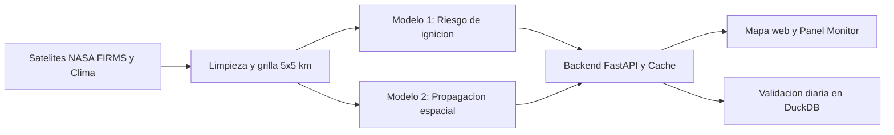

# Documentación del proyecto FHIPredict

**FHIPredict** es una plataforma web autónoma para estimar el riesgo diario de incendios forestales en Argentina (de 1 a 15 días), proyectar su posible propagación hacia zonas vecinas (de 24 a 72 horas) y verificar cada día qué tan bien acertó el sistema frente a los focos reales detectados por satélites de la NASA.

> [!NOTE]
> Esta guía está pensada para comprender el proyecto de punta a punta con claridad y sin fórmulas matemáticas complejas.

---

## Panorama general de punta a punta

El sistema conecta datos satelitales y meteorológicos con dos modelos predictivos, los sirve desde un backend ligero en Python y los muestra en un mapa interactivo y un tablero de control empírico.

---

## Ruta de lectura recomendada

Cada documento responde a una pregunta concreta y se apoya en el anterior:

| Orden | Documento | Qué pregunta responde |
|---|---|---|
| 0 | [00-indice.md](00-indice.md) | Qué es FHIPredict y cómo se organiza todo el ecosistema. |
| 1 | [01-datos-y-limpieza.md](01-datos-y-limpieza.md) | De dónde salen los datos, cómo se limpian y cómo se construye la grilla de Argentina. |
| 2 | [02-modelos-y-prediccion.md](02-modelos-y-prediccion.md) | Qué predicen ambos modelos, cómo aprendieron sin hacer trampa y cómo leer las alertas. |
| 3 | [03-arquitectura-backend-y-monitor.md](03-arquitectura-backend-y-monitor.md) | Cómo funciona el servidor, la caché, los endpoints y el monitor empírico con DuckDB. |
| 4 | [04-frontend-y-experiencia.md](04-frontend-y-experiencia.md) | Qué ofrece el mapa operativo, el panel `/monitor` y cómo interpretar sus gráficos. |
| 5 | [05-operacion-despliegue-y-limites.md](05-operacion-despliegue-y-limites.md) | Cómo ejecutarlo en local, cómo está desplegado en DonWeb1 y qué limitaciones reales tiene. |
| 6 | [06-evolucion-del-modelo-ml.md](06-evolucion-del-modelo-ml.md) | Cómo evolucionó el modelo (`v2` → `v3` → `v4`), qué problemas se resolvieron y por qué existe un límite teórico. |

---

## Mapa de repositorios del ecosistema

Aunque hoy FHIPredict corre de forma totalmente independiente en producción, su construcción se apoya en tres repositorios que cumplen roles distintos:

| Repositorio | Rol principal | Qué aporta |
|---|---|---|
| `ML_NasaSpaceApp-post-hackathon` | Limpieza y armonización inicial | Limpia los CSV crudos de satélites MODIS y VIIRS (`clean_firms.py`), filtra ruido y antorchas industriales, y genera la base armonizada. |
| `ModeloPredictivo-2026-post-hackathon` | Entrenamiento del modelo de ignición | Descarga clima histórico de NASA POWER (`ingest_nasapower.py`) y entrena el modelo de inicio de fuego a 24 horas (`train_predictive_risk.py`). |
| `FHIPredict-post-hackathon` *(este repositorio)* | Producción, propagación y monitoreo | Sirve la API y el mapa web, entrena el modelo de propagación (`train_spread.py`), conecta pronósticos en vivo de Open-Meteo y audita aciertos diarios contra NASA FIRMS. |

---

## Siguiente lectura

Comienza por [01-datos-y-limpieza.md](01-datos-y-limpieza.md) para entender cómo se depuran las señales satelitales y meteorológicas antes de entrenar cualquier modelo.
