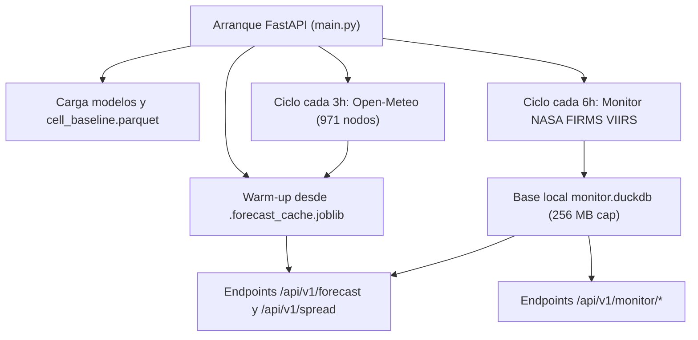

# 3. Arquitectura del backend, caché y monitor empírico

Un único servicio en **FastAPI** (Python 3.12+) ejecuta ambos modelos LightGBM en memoria, consulta el clima externo con control de tráfico, sirve la aplicación web compilada y audita cada día el rendimiento real contra satélites NASA FIRMS dentro de un presupuesto estricto de 1 GB de RAM.

---

## Flujo interno del servidor

Al arrancar, el servidor carga los artefactos preentrenados desde `backend/models/`, levanta la caché de disco para responder de inmediato y lanza dos ciclos periódicos en segundo plano (refresco de pronóstico cada 3 horas y verificación satelital cada 6 horas).

---

## Mapa de archivos del backend (`backend/app/`)

| Archivo | Responsabilidad principal |
|---|---|
| `main.py` | Define los 7 endpoints HTTP, compresión GZip (`>= 1024` bytes), CORS, tareas de inicio (*lifespan*) y entrega de archivos estáticos del frontend. |
| `config.py` | Centraliza variables de entorno (`RISK_CUTOFF_MODE`, `FIRMS_MAP_KEY`, intervalos de caché/monitoreo, límites de confianza). |
| `service.py` | Orquesta el cálculo de 15 días, mezcla la memoria de fuego viva de VIIRS, resuelve umbrales diarios, calcula la propagación y arma respuestas GeoJSON (top 20.000 celdas). |
| `predictor.py` | Carga `fire_risk_bundle.joblib`, calcula estabilidad por profundidad de árboles (para la confianza heurística) y aplica percentiles diarios acotados. |
| `spread.py` | Construye el grafo de 8 vecinos (`429.722` aristas dirigidas dentro de `8,5 km`), carga `spread_bundle.joblib` y fusiona riesgo base + propagación. |
| `openmeteo.py` | Consulta los `971` nodos meteorológicos (30 días pasados + 15 futuros) en lotes de `100` con 1 petición simultánea, pausas de `0,35 s` y reintentos ante límites `429`. |
| `monitor/snapshots.py` | Administra la base `monitor_data/monitor.duckdb` (`memory_limit="256MB"`, 1 hilo) y guarda los snapshots diarios de 24 horas. |
| `monitor/firms.py` | Descarga detecciones `VIIRS_SNPP_NRT`, `VIIRS_NOAA20_NRT` y `VIIRS_NOAA21_NRT`, descarta confianza baja (`'l'`) y mapea cada foco a su celda más cercana (`<= 6 km`). |
| `monitor/evaluator.py` | Calcula en NumPy puro las métricas diarias y clasifica cada celda en acierto (*hit*), omisión (*miss*) o falsa alarma (*false alarm*). |
| `monitor/service.py` | Coordina la ejecución asíncrona del monitor con bloqueo exclusivo (`asyncio.Lock`) para evitar carreras de escritura en DuckDB. |

---

## Los 7 endpoints de la API

| Método y ruta | Para qué sirve | Detalles clave |
|---|---|---|
| `GET /api/v1/health` | Estado de salud del servidor. | Devuelve versiones de ambos modelos, total de celdas (`64.653`), nodos (`971`) y estado de caché. |
| `GET /api/v1/forecast` | GeoJSON de riesgo de ignición. | Soporta `mode=day` (un día) o `mode=window` (pico máximo en ventana de 1–15 días), `min_risk`, `bbox` y `refresh`. |
| `GET /api/v1/spread` | GeoJSON de propagación espacial. | Evalúa horizontes `24`, `48` o `72` horas; devuelve `meta.source_cutoff` alineado con `/forecast`. |
| `GET /api/v1/monitor/status` | Estado del proceso de auditoría VIIRS. | Informa si hay una corrida en curso, última actualización y si falta `FIRMS_MAP_KEY`. |
| `GET /api/v1/monitor/metrics` | Serie histórica de métricas diarias. | Devuelve hasta `limit` días evaluados con precisión, lift, aciertos, omisiones y falsas alarmas por categoría. |
| `GET /api/v1/monitor/comparison` | GeoJSON de aciertos vs. fallos por día. | Devuelve puntos `hit`, `miss` y `false_alarm` para `target_date` (omite verdaderos negativos para mantener respuestas livianas). |
| `POST /api/v1/monitor/run` | Dispara una auditoría manual en segundo plano. | Responde `202 Accepted` de inmediato. Requiere `FIRMS_MAP_KEY` configurada; si está vacía responde `400`. |

---

## Cómo se protege la memoria y las APIs externas

1. **Caché atómica en disco (`.forecast_cache.joblib`):** tiene un tiempo de vida de 3 horas (`CACHE_TTL_S=10800`) y usa patrón *stale-while-revalidate*: si la caché venció, el usuario recibe una respuesta inmediata con el dato anterior mientras un proceso en segundo plano la actualiza sin bloquear peticiones.
2. **Protección contra bloqueos de Open-Meteo:** consultar 971 coordenadas de golpe dispararía errores `429`. Por eso se piden en bloques secuenciales de 100 nodos con pausas y espera exponencial ante fallos; si Open-Meteo cae temporalmente, se conserva la caché anterior por 60 segundos antes de reintentar.
3. **Control de tamaño de respuesta:** aunque Argentina tiene `64.653` celdas, los endpoints GeoJSON filtran por categoría mínima y devuelven como tope las `20.000` celdas de mayor riesgo, comprimidas con GZip.

---

## Cómo funciona el monitor empírico en DuckDB

Toda la auditoría diaria vive en un único archivo local `monitor_data/monitor.duckdb` con tres tablas principales:

| Tabla | Qué guarda |
|---|---|
| `forecast_snapshots_24h` | La foto diaria del pronóstico a 24 horas (probabilidad y categoría asignada por celda para cada fecha emitida). |
| `viirs_cell_daily` | Las detecciones reales de NASA FIRMS VIIRS agregadas por fecha, satélite y celda (conteo de focos, potencia acumulada y máxima). |
| `daily_eval_metrics` | El resumen diario de desempeño al cruzar pronóstico contra realidad (`ROC-AUC`, `PR-AUC`, calibración, hits, misses y desglose por categoría). |

Cada día completado se compara el snapshot guardado contra los focos VIIRS que superan el criterio de evento relevante (`>= 1` detección y suma de FRP `>= 10 MW`). Si un día actual todavía está en curso, sus detecciones satelitales siguen llegando de forma parcial.

---

## Checklist de comprensión

- [ ] Entiendo cómo la caché en disco evita depender de Open-Meteo en cada visita del mapa.
- [ ] Entiendo que el monitor guarda el pronóstico a 24h antes de que ocurra el día para poder auditarlo de forma honesta cuando llegan los satélites.
- [ ] Entiendo qué rol cumple cada una de las 3 tablas de `monitor.duckdb`.

## Siguiente lectura

Continúa con [04-frontend-y-experiencia.md](04-frontend-y-experiencia.md) para explorar la interfaz web, sus dos vistas y cómo leer sus controles.
